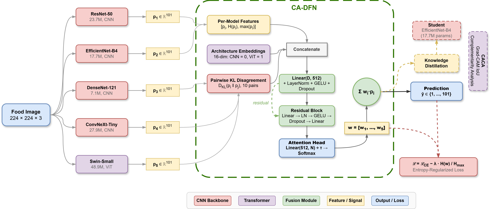

# Trustworthy Food Image Recognition via Confidence-Aware Dynamic Fusion of CNNs and Transformers

Official PyTorch implementation of **CA-DFN**, a learned per-sample fusion
network that combines five architecturally diverse backbones into a
*trustworthy* ensemble for food image recognition, together with
**CACA** (Cross-Architecture Complementarity Analysis) and the first
calibration study for the food-recognition domain.

> Ensembles of CNNs and Transformers deliver strong visual recognition, yet
> conventional ensembles fuse predictions with fixed rules that cannot adapt
> to individual inputs and leave prediction confidence uncalibrated. CA-DFN
> addresses both limitations with an entropy-regularised, architecture-aware
> attention mechanism that produces per-sample fusion weights.

---

## Highlights

- **CA-DFN** — a learned per-sample fusion network using architecture-type
  embeddings, pairwise KL-divergence disagreement features, and
  entropy-regularised, temperature-scaled attention that keeps all ensemble
  members active (no weight collapse).
- **CACA** — a Grad-CAM IoU diagnostic giving the first geometric measure of
  CNN–Transformer complementarity, and the finding that complementarity is
  *necessary but not sufficient* for fusion benefit (r = −0.915).
- **First calibration analysis for food recognition** — Expected Calibration
  Error, reliability diagrams, entropy distributions, and selective-prediction
  curves.
- **Curriculum knowledge distillation** — compresses the ensemble into a
  single EfficientNet-B4 student for deployment.

---

## Main results (Food-101, seed 42)

### Base models

| Model | Type | Params (M) | GFLOPs | Top-1 (%) | Top-5 (%) | F1 |
|---|---|---:|---:|---:|---:|---:|
| ResNet-50 | CNN | 23.7 | 4.13 | 87.72 | 97.42 | 0.8770 |
| EfficientNet-B4 | CNN | 17.7 | 1.57 | 85.23 | 97.10 | 0.8513 |
| DenseNet-121 | CNN | 7.1 | 2.90 | 86.00 | 97.05 | 0.8594 |
| ConvNeXt-Tiny | CNN | 27.9 | 4.49 | 89.89 | 98.09 | 0.8986 |
| Swin-Small | Transformer | 48.9 | 8.56 | 92.34 | 98.60 | 0.9231 |

### Ensemble fusion

| Fusion method | Top-1 (%) | Top-5 (%) | F1 |
|---|---:|---:|---:|
| Majority vote | 90.93 | — | — |
| Uniform average | 92.00 | — | 0.9198 |
| Performance-weighted | 92.08 | — | 0.9206 |
| **CA-DFN (ours)** | **92.63** | **98.87** | **0.9261** |

### Trustworthiness and deployment

| Metric | Value |
|---|---|
| Expected Calibration Error (ECE) | 0.0423 |
| Accuracy @ 80% coverage | 98.35% |
| Mean CNN–Transformer complementarity | 0.967–0.987 |
| Complementarity ↔ fusion-gain correlation | r = −0.915 |
| Distilled student (EfficientNet-B4) | 85.24% Top-1 (92.0% of teacher) |

---

## Installation

```bash
git clone https://github.com/gulzara3/ca-dfn.git
cd ca-dfn
python -m venv .venv && source .venv/bin/activate
pip install -r requirements.txt
```

Tested with Python 3.10 and CUDA 12.x on a single 12 GB GPU
(NVIDIA TITAN Xp). Food-101 (~5 GB) is downloaded automatically on first run.

---

## Usage

Run the full pipeline (train base models → CA-DFN → CACA → calibration →
distillation → efficiency → ablations):

```bash
python main.py                 # default seed (42)
python main.py --seed 123      # reproduce with another seed
python main.py --no-download   # Food-101 already in ./data
```

All figures and tables are written to `results/`. Trained checkpoints are
saved to `checkpoints/`.

A single self-contained Jupyter notebook that reproduces every figure is
provided in [`notebooks/FoodVision_CA-DFN.ipynb`](notebooks/).

---

## Repository structure

```
ca-dfn/
├── main.py                 # end-to-end pipeline orchestrator
├── requirements.txt
├── src/
│   ├── config.py           # all hyperparameters (single source of truth)
│   ├── data.py             # Food-101 transforms, CutMix/MixUp, dataloaders
│   ├── models.py           # five-backbone factory (differential LR)
│   ├── train.py            # base-model training / evaluation engine
│   ├── cadfn.py            # CA-DFN network + entropy-regularised loss
│   ├── fusion.py           # caching, static baselines, CA-DFN training
│   ├── caca.py             # Cross-Architecture Complementarity Analysis
│   ├── calibrate.py        # ECE, reliability, selective prediction
│   ├── distill.py          # curriculum knowledge distillation
│   ├── efficiency.py       # params/FLOPs/latency + Pareto plot
│   └── analysis.py         # ablations, training curves, confusion, weights
├── notebooks/              # single-file reproduction notebook
└── results/                # generated figures and efficiency.csv
```

---

## Method overview



Five base models each produce a softmax distribution over the 101 Food-101
classes. CA-DFN extracts per-model confidence features, architecture-type
embeddings, and pairwise KL-divergence disagreement signals; a residual MLP
with temperature-scaled, entropy-regularised attention yields per-sample
weights `w = [w1 … w5]`. The weighted prediction is used for classification,
analysed for complementarity (CACA) and calibration, and distilled into a
compact student.

Key hyperparameters (see `src/config.py`): attention temperature τ = 3.0,
entropy weight λ = 0.3, input-model dropout 0.25, distillation temperature
T = 4.0, KD balance α = 0.7, label smoothing ε = 0.1, 50 base-model epochs,
40 fusion/KD epochs, effective batch size 64.

---

## Citation

If you use this code, please cite:

```bibtex
@article{cadfn2026,
  title   = {Trustworthy Food Image Recognition via Confidence-Aware
             Dynamic Fusion of CNNs and Transformers},
  author  = {Ahmad, Izhar and Rasheed, Muhammad and Alam, Gulzar},
  journal = {Neurocomputing (under review)},
  year    = {2026}
}
```

---

## License

Released under the MIT License — see [LICENSE](LICENSE).

## Acknowledgements

Built on [PyTorch](https://pytorch.org/), [timm](https://github.com/huggingface/pytorch-image-models),
[pytorch-grad-cam](https://github.com/jacobgil/pytorch-grad-cam), and
[ptflops](https://github.com/sovrasov/flops-counter.pytorch). Evaluated on the
[Food-101](https://data.vision.ee.ethz.ch/cvl/datasets_extra/food-101/) dataset.
